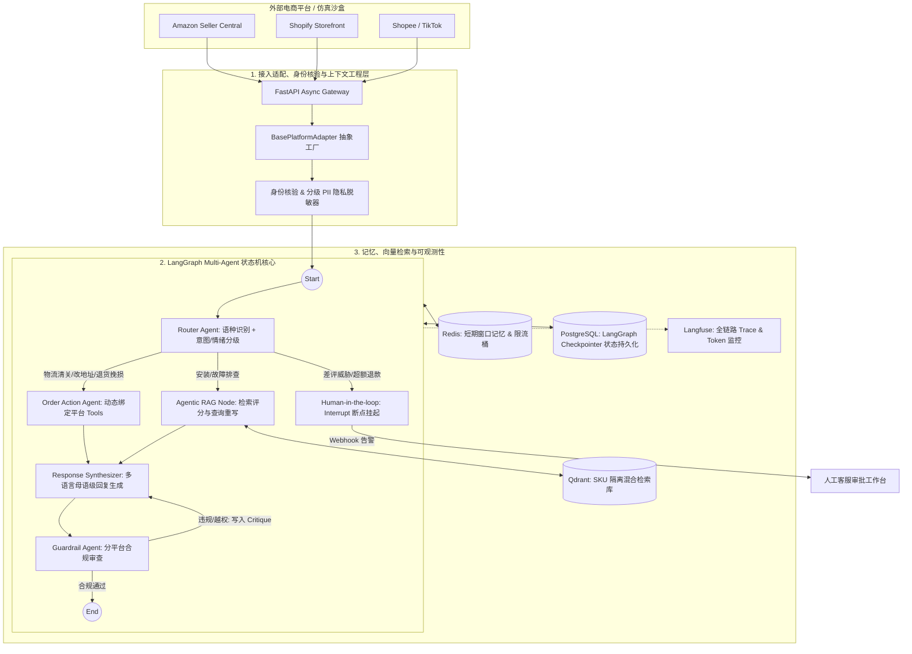

# 🤖 CrossBorder-Support-Agent

**面向多平台跨境电商的智能客服与订单自动化 Multi-Agent 系统**

[](https://python.org)
[](https://github.com)
[](https://tiangolo.com)
[](https://qdrant.tech)
[](https://langfuse.com)

> **项目定位：** 本项目旨在解决跨境电商多渠道（Amazon、Shopify、Shopee/TikTok）运营中“平台规则高度割裂、跨国物流与清关查询高频、售后依赖实时订单与退货算账、平台封号红线严苛”等生产痛点。系统摒弃传统的单体 Prompt 问答模式，基于 **LangGraph 状态机** 构建了支持**动态工具注册、Agentic RAG、双重合规反思护栏（Self-Correction）与人机协同（Human-in-the-loop）**的通用型 Multi-Agent 引擎。

---

## 📖 1. 业务背景与需求分析 (Requirements Analysis)

### 1.1 跨平台核心业务痛点
1. **平台权限与合规红线极度割裂：**
   * **Amazon：** 区分 FBA/FBM 物流责任，站内信严禁出现外部链接、联系方式或诱导五星好评词汇（违规直接导致封号），AI 仅允许生成合规草稿或执行只读查询。
   * **Shopify：** 独立站生态拥有高度自由的 API 权限，AI 可直接调用工具执行“修改未发货订单地址、取消订单、生成补偿折扣码”等写操作。
   * **Shopee / TikTok：** 东南亚社交电商高频出现货到付款（COD）拒收风险及多语种混合表达（如英/马/泰/中夹杂）。
2. **跨国物流长链路与逆向退货成本极高：**
   * 物流涉及“国内揽收—干线—目的国清关—尾程派送”，状态晦涩且易受海关抽检与税费（DDP/DDU）影响，引发海量催单（WISMO）；同时跨国退货运费往往高于商品货值，盲目同意退货易导致卖家“货财两空”。
3. **上下文缺失与高危客诉绩效风险：**
   * 脱离买家实时订单状态、物流轨迹及具体 SKU 电子说明书无法闭环；威胁留差评、发起 A-to-Z 索赔或高额退款请求若未及时触发人工接管，将直接恶化店铺订单缺陷率（ODR）。

### 1.2 核心需求拆解（业务痛点 → AI Agent 架构映射）

| 业务需求                   | Agent 工程化设计方案                                         | 核心技术关键词                                          |
| :------------------------- | :----------------------------------------------------------- | :------------------------------------------------------ |
| **多平台零侵入扩展**       | 设计统一标准化模型（Canonical Data Model）与平台适配器层，屏蔽异构平台 JSON 差异。 | `Adapter Pattern`, `Pydantic v2`                        |
| **按平台隔离 AI 操作权限** | 依据当前会话所属平台与订单状态，在运行时动态向 LLM 绑定允许调用的 Function Tools，写操作强制绑定幂等键。 | `Dynamic Tool Binding`, `Idempotency Key`               |
| **物流追踪与阶梯挽损谈判** | 聚合多段跨国物流与清关状态；基于“货值 vs 逆向运费”算账模型，自动执行阶梯式部分退款/发券挽留或本地仓退货路由。 | `WISMO Tracking`, `Tiered Retention Policy`             |
| **多意图复杂任务编排**     | 将系统拆解为意图路由、订单执行、知识检索、合规审查 4 个专业子智能体，通过有向图流转状态。 | `LangGraph StateGraph`, `Supervisor / Router`           |
| **复杂说明书高精度排查**   | 针对包含大量型号参数与错误码的 PDF 说明书，构建按 SKU 隔离的自省式混合检索管道。 | `Agentic RAG`, `Hybrid Search`, `BGE-Reranker`          |
| **零违规风控与安全兜底**   | 强制买家身份核验；引入“确定性规则 + LLM 反思重写”双层护栏；高危工单触发断点挂起并推送人工审批。 | `Self-Correction Loop`, `Human-in-the-loop (Interrupt)` |

---

## 🏗️ 2. 系统架构与 Agent 状态机设计 (System & Agent Architecture)

### 2.1 整体四层解耦架构



### 2.2 核心 Agent 节点与流转机制详解

1. **`AgentState` 全局状态定义：**
   - 维护 `messages`（对话历史）、`platform`（平台标识）、`is_verified`（买家身份核验状态）、`unified_order`（标准订单与物流清关上下文）、`intent`（意图标签）、`risk_score`（客诉风险分）、`retrieved_docs`（召回知识片段）以及 `critique`（风控打回修改意见）。
2. **上下文感知的动态工具绑定与幂等执行（Dynamic Tool Binding & Idempotency）：**
   - 在进入 `Order Action Agent` 节点前，系统首先校验 `is_verified`（如比对下单邮箱或原邮编），随后根据 `state["platform"]` 动态注入受限的 `StructuredTool` 列表，且所有写操作强制携带 `idempotency_key` 防重复调用资损：
     - **Shopify 场景：** 注入 `track_cross_border_shipment`、`update_shipping_address`、`cancel_order`、`evaluate_return_retention`（阶梯挽损算账工具）及 `issue_discount_code`。
     - **Amazon 场景：** 物理剥离所有直接改单/退款写操作工具，仅绑定 `track_cross_border_shipment` 与 `generate_vat_invoice`，从底层架构杜绝 AI 越权操作。
3. **双重合规护栏与自我修正循环（Self-Correction Guardrail）：**
   - **第一层（确定性正则安检）：** 毫秒级拦截外部 URL、邮箱、WhatsApp/PayPal 字样及诱导好评敏感词。
   - **第二层（Policy LLM 审查）：** 校验回复是否符合当前平台的售后权责（如 Amazon FBA 订单物流破损应引导买家联系官方客服，而非承诺卖家直接补发）。若审查不通过，将违规原因写入 `state["critique"]` 并路由回 `Response Synthesizer` 重新生成（设置 `max_retries=2`，超限自动降级转人工）。
4. **人机协同断点挂起（Human-in-the-loop）：**
   - 利用 LangGraph 的 `interrupt_before=["human_approval"]` 与 `AsyncPostgresSaver` 持久化当前状态快照。当识别到 `A-to-Z` 索赔威胁、破损理赔或退款金额 > $100 时，状态机挂起并推送工单至人工台；待客服在前端点击“批准/修改发送”后，通过 `Command(resume=...)` 恢复图执行。

------

## 🧠 3. Agentic RAG 与上下文工程优化 (Context & RAG Engineering)

针对跨境硬件/家居类商品 PDF 说明书包含大量型号参数、结构说明与故障代码（如 `Error E04`）的特点，设计了具备自省能力的检索管道：

1. **Parent-Child 父子文档分块：** 使用小切片（256 tokens）计算向量相似度以提升召回精度，命中后映射返回所属的完整章节父切片（1024 tokens），确保故障排查步骤不被截断。
2. **SKU 元数据强隔离（Metadata Filtering）：** 检索时强制注入 `filter={"sku": unified_order.sku}`，100% 杜绝不同型号产品的说明书参数串台。
3. **双路混合检索 + 重排（Hybrid Search + Rerank）：** 结合 Qdrant 稠密向量检索与 `BM25` 稀疏关键词检索（精准捕捉型号与错误码），再通过 `BGE-Reranker-v2-m3` 进行交叉编码重排。
4. **检索质量自省（Corrective RAG 思想）：** `RAG Node` 对 Top-K 重排分数设定阈值（如 `score < 0.45`）。若相关度过低，Agent 自动触发 **Query Rewrite（多语言查询改写，将买家口语化描述转化为专业术语）** 进行二次检索；若仍无结果，则诚实反馈并路由转人工，严禁模型编造排查步骤（Zero Hallucination）。
5. **分级 PII 隐私脱敏与工具参数透传：** 历史订单中的买家真实姓名、手机号、原收货地址在进入 LLM 上下文前通过正则与 NER 替换为占位符（如 `[CUSTOMER_NAME]`、`[ORIG_ADDRESS_TOKEN]`）；而买家在当前对话中新提交的修改参数（如改地址场景下的新街道地址）则写入受控状态变量直接透传给后端 Tool，在最终输出发送前再从 Redis 安全映射表中按需还原，既保护隐私又确保工具调用精确无误。

------

## 📊 4. 量化评估体系 (Agent & RAG Evaluation)

为避免“凭感觉调 Prompt”，项目集成了自动化评估流水线，使用 **Ragas** 与自定义业务数据集（100 条跨平台仿真多语言工单）进行基准测试：

| 评估维度                 | 评估指标                      | 基线方案 (单体 Prompt + 基础向量检索) | **本系统 (Multi-Agent + Hybrid RAG + Guardrail)** | 核心优化归因                                        |
| ------------------------ | ----------------------------- | ------------------------------------- | ------------------------------------------------- | --------------------------------------------------- |
| ***\*检索准确性\****     | Context Recall (上下文召回率) | 64.5%                                 | **92.0%**                                         | 父子分块 + BM25 混合检索 + SKU 隔离                 |
| ***\*回答忠实度\****     | Faithfulness (无幻觉率)       | 76.0%                                 | **96.5%**                                         | 重排阈值过滤 + Query Rewrite 机制                   |
| ***\*平台合规率\****     | 政策遵守率                    | 81.0%                                 | **100.0%**                                        | 正则硬拦截 + Policy LLM 反思重写闭环                |
| ***\*意图与工具路由\**** | 工具调用准确率                | 84.0%                                 | **95.5%**                                         | 动态工具绑定缩小工具空间 + Pydantic 强校验          |
| ***\*端到端延迟\****     | P95 响应耗时 (不含人工挂起)   | 4.8秒                                 | **2.6秒**                                         | FastAPI 全异步并发 + 轻量级路由模型 (`gpt-4o-mini`) |

------

## 🛠️ 5. 技术栈选型 (Tech Stack)

- **AI Agent 编排：** `LangGraph` (StateGraph, Checkpointer, Human-in-the-loop), `LangChain Core`
- **RAG 与向量引擎：** `Qdrant` (Hybrid Search), `PyMuPDF`, `Rank-BM25`, `BGE-Reranker`
- **后端与数据校验：** `Python 3.11`, `FastAPI` (Asyncio), `Pydantic v2`
- **存储与中间件：** `PostgreSQL` (异步持久化与状态快照), `Redis` (对话窗口记忆、PII 映射与令牌桶限流)
- **可观测性与评估：** `Langfuse` (全链路 Trace / Latency / Token 监控), `Ragas` (自动化评估)
- **仿真前端与部署：** `Streamlit` (多平台交互演示工作台), `Docker Compose`

------

## 📂 6. 项目目录结构 (Project Structure)

```````bash
CrossBorder-Support-Agent/
├── app/
│   ├── adapters/               # 多平台适配器层 (Adapter & Factory Pattern)
│   │   ├── base.py             # BasePlatformAdapter 抽象基类
│   │   ├── factory.py          # 平台适配器工厂
│   │   ├── amazon_mock.py      # Amazon 适配器 (含 FBA/FBM 逻辑与限流模拟)
│   │   ├── shopify.py          # Shopify 适配器 (支持真实沙盒 API)
│   │   └── shopee_mock.py      # Shopee/TikTok 适配器 (含 COD 与混合语模拟)
│   ├── agents/                 # LangGraph 多智能体状态机核心
│   │   ├── state.py            # AgentState 全局状态与 Pydantic Schema
│   │   ├── graph.py            # StateGraph 状态机拓扑与条件边路由
│   │   ├── nodes.py            # Router, Order, RAG, Synthesizer, Guardrail 节点
│   │   └── tools.py            # 按平台权限动态注册与幂等校验的 Function Tools
│   ├── guardrails/             # 分平台合规安检规则引擎 (正则 + Policy LLM)
│   ├── rag/                    # Agentic RAG 管道
│   │   ├── ingestion.py        # PDF 说明书解析与父子分块入库
│   │   └── retriever.py        # Qdrant 向量 + BM25 混合检索与重排
│   ├── schemas/                # UnifiedOrder / UnifiedMessage 统一标准模型
│   ├── utils/                  # 身份核验、分级 PII 脱敏器、Redis 限流桶、多语言检测
│   └── main.py                 # FastAPI 异步入口与 Webhook 接收
├── evals/                      # 自动化评估集 (100条跨平台测试用例 + Ragas 评估脚本)
├── frontend/                   # Streamlit 多平台仿真交互工作台 (支持人工审批演示)
├── data/                       # 示例多 SKU 产品 PDF 说明书与 Mock 数据库
├── docker-compose.yml          # 一键启动 FastAPI + Qdrant + Redis + Postgres
├── pyproject.toml              # 项目依赖与构建配置
└── README.md
```

------

## 🚀 7. 快速启动与交互演示 (Quick Start)

### 7.1 启动基础设施

```bash
git clone https://github.com/Lee256-Ace/CrossBorder-Support-Agent.git
cd CrossBorder-Support-Agent

# 配置环境变量 (填入 LLM API Key 与可选的 Langfuse 监控密钥)
cp .env.example .env

# 启动 Qdrant, Redis, PostgreSQL
docker-compose up -d
```

### 7.2 初始化知识库与运行系统

```bash
# 使用 pyproject.toml 安装依赖
pip install -e .

# 1. 解析示例产品 PDF 说明书并构建混合检索索引
python -m app.rag.ingestion --data-dir ./data/manuals

# 2. 启动 FastAPI 后端服务
uvicorn app.main:app --reload --port 8000

# 3. 启动 Streamlit 多平台仿真控制台
streamlit run frontend/app.py
```

------

## 🎯 8. 控制台内置核心演示场景 (Demo Scenarios)

启动前端控制台后，可通过下拉菜单一键切换以下 4 个典型跨平台测试场景，观察 Agent 的动态路由与风控拦截表现：

1. **【Amazon - 违规引流拦截与差评熔断】**
   - *买家输入：* `"The coffee maker leaks water! Send me a refund to my PayPal or I will leave a 1-star review and file A-to-Z!"`
   - *系统表现：* 识别为高危客诉 $\rightarrow$ 状态机触发 `Human-in-the-loop` 断点挂起告警 $\rightarrow$ `Guardrail` 节点自动拦截草稿中的外部支付引导词并执行自我修正。
2. **【Shopify - 身份核验与动态工具自主闭环】**
   - *买家输入：* `"Hi, I just placed order #SHP-9021 (email: alex@example.com), can you change my shipping address to 742 Evergreen Terrace? It hasn't shipped yet."`
   - *系统表现：* 校验下单邮箱通过 $\rightarrow$ `Order Action Agent` 动态绑定 `update_shipping_address`（携带幂等键） $\rightarrow$ 确认状态为 `UNFULFILLED` 后透传新地址完成修改并返回确认信息。
3. **【跨国物流 - 清关滞留安抚与 DDP 税费解释 (WISMO)】**
   - *买家输入：* `"Why is my parcel #TRK-88412 stuck in Los Angeles Customs for 5 days? Do I need to pay extra import tax?"`
   - *系统表现：* 调用 `track_cross_border_shipment` 解析最新海关查验节点 $\rightarrow$ 识别订单为 `DDP（包税）` 渠道 $\rightarrow$ 明确告知卖家已承担关税、无需买家额外付费，并给出预计清关放行窗口安抚情绪。
4. **【全平台通用 - 德/日语复杂故障排查 Agentic RAG】**
   - *买家输入（德语）：* `"Mein Gerät blinkt rot (Fehler E04) und startet nicht."`
   - *系统表现：* 自动识别德语并关联订单中的 `SKU-CM200` $\rightarrow$ 通过元数据隔离的混合检索命中说明书故障树 $\rightarrow$ 输出地道分步德语排查指南。
