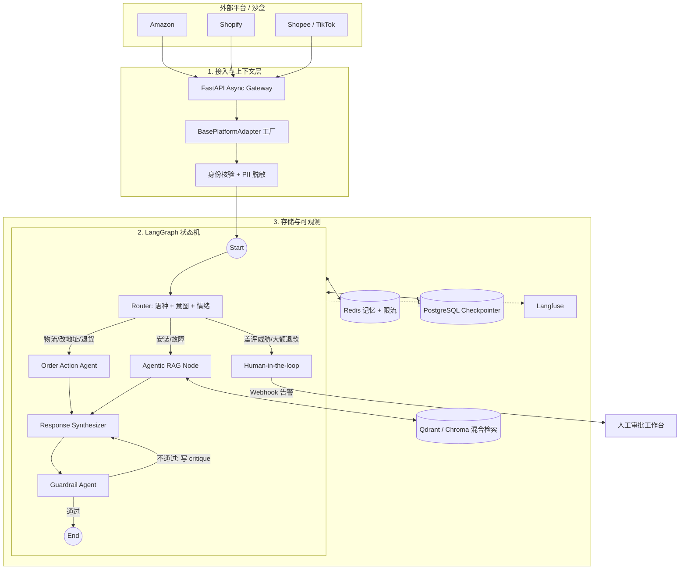

# 系统架构 · CrossBorder-Support-Agent

本文档描述 **当前已实现架构** 与 **目标架构**，并标注两者的差距。

---

## 1. 当前已实现架构（MVP-0）

```mermaid
graph LR
    subgraph Client[客户端]
        CURL[curl / 前端]
    end

    subgraph App[FastAPI 应用 app.main:app]
        H[/GET /api/health/]
        O[/GET /api/orders/&#123;order_id&#125;/]
        R[app/routers/orders.py]
    end

    subgraph Core[核心层 app/core]
        CFG[config.Settings 单例]
        DB[database: async engine + async_session]
        LLM[llm: ChatOpenAI]
    end

    subgraph Data[存储]
        PG[(PostgreSQL 16 · crossborder)]
        CH[(Chroma 1.5.9)]
    end

    CURL --> H & O
    O --> R --> DB --> PG
    R -.读取.-> CFG
    LLM -.读取.-> CFG
    Core -.未接入.-> CH
```



### 1.1 分层职责

| 层 | 目录 / 文件 | 职责 | 状态 |
| :--- | :--- | :--- | :--- |
| 应用入口 | [app/main.py](../app/main.py) | 创建 FastAPI 实例、注册路由、健康检查 | ✅ |
| 路由层 | [app/routers/orders.py](../app/routers/orders.py) | HTTP 契约、参数校验、错误码 | ✅ |
| 核心配置 | [app/core/config.py](../app/core/config.py) | 环境变量加载（pydantic-settings） | ✅ |
| 数据访问 | [app/core/database.py](../app/core/database.py) | 异步引擎、会话工厂、`get_db` 依赖注入 | ✅ |
| LLM 客户端 | [app/core/llm.py](../app/core/llm.py) | OpenAI 兼容 ChatModel，`temperature=0` | ✅ |
| 数据模型 | [app/models/order.py](../app/models/order.py) | SQLAlchemy 2.x `Mapped` 风格 ORM | ✅ |
| 初始化脚本 | [init_db.py](../init_db.py) | 建表 + 插入种子订单 | ✅ |
| 平台适配器 | `app/adapters/`（未创建） | 屏蔽异构平台差异 | ⬜ |
| Agent 编排 | `app/agents/`（仅空包） | LangGraph 状态机 | ⬜ |
| RAG | `app/rag/`（未创建） | 入库 + 混合检索 | ⬜ |
| 护栏 | `app/guardrails/`（未创建） | 正则 + Policy LLM | ⬜ |
| Schema | `app/schemas/`（仅空包） | `UnifiedOrder` / `UnifiedMessage` | ⬜ |
| 评估 | `evals/`（未创建） | Ragas 流水线 | ⬜ |
| 前端 | `frontend/`（未创建） | Streamlit 仿真工作台 | ⬜ |

### 1.2 请求链路（订单查询）

```
GET /api/orders/ORD-1001
  └─ FastAPI 依赖注入 get_db() → 创建 AsyncSession
       └─ select(Order).where(Order.order_id == order_id)
            └─ asyncpg → PostgreSQL
                 └─ 命中返回 {order_id,status,amount}；未命中抛 404
  └─ finally: await session.close()
```

---

## 2. 数据模型

### 2.1 `orders` 表（当前唯一表）

| 字段 | 类型 | 约束 | 说明 |
| :--- | :--- | :--- | :--- |
| `id` | int | PK, autoincrement | 自增主键 |
| `order_id` | varchar(32) | unique, index | 业务订单号，如 `ORD-1001` |
| `platform` | varchar(16) | | `amazon` / `shopify` / `shopee` |
| `customer_email_suffix` | varchar(8) | | 邮箱后 4 位，用于身份核验（脱敏存储） |
| `status` | varchar(16) | | 订单状态，如 `delivered` |
| `paid_amount` | numeric(10,2) | | 实付金额 |
| `currency` | varchar(8) | default `USD` | 币种 |
| `items_summary` | varchar(255) | | 商品摘要 |
| `created_at` | datetime | server_default `now()` | 创建时间 |

### 2.2 规划补充

- `sku` / `tracking_no` / `fulfillment_type`（FBA/FBM）/ `tax_mode`（DDP/DDU）
- 物流轨迹子表 `shipment_events`
- 会话表 `conversations` / `messages`（或交给 LangGraph Checkpointer）

---

## 3. API 契约（当前）

| 方法 | 路径 | 说明 | 响应 |
| :--- | :--- | :--- | :--- |
| GET | `/api/health` | 健康检查 | `{"ok": true}` |
| GET | `/api/orders/{order_id}` | 只读订单查询 | `{"order_id","status","amount"}`，不存在返回 404 |

### 3.1 规划中的接口

| 方法 | 路径 | 说明 |
| :--- | :--- | :--- |
| POST | `/api/webhooks/{platform}` | 接收平台消息回调，触发 Agent 图 |
| POST | `/api/chat` | 仿真对话入口（供 Streamlit 调用） |
| GET | `/api/approvals/pending` | 人工审批待办列表 |
| POST | `/api/approvals/{thread_id}/resume` | `Command(resume=...)` 恢复挂起的图 |
| POST | `/api/auth/login` | 管理员 JWT 登录（`SECRET_KEY` 已预留） |

---

## 4. 目标架构（README 设计）



### 4.1 `AgentState` 关键字段

```
messages: list            # 对话历史
platform: str             # 当前平台
is_verified: bool         # 买家身份核验
unified_order: dict       # 标准化订单 + 物流清关上下文
intent: str               # 意图标签
risk_score: float         # 客诉风险分
retrieved_docs: list      # 召回知识片段
critique: str | None      # 护栏打回意见
```

### 4.2 动态工具绑定（按平台隔离权限）

| 平台 | 可用工具 |
| :--- | :--- |
| Shopify | `track_cross_border_shipment`、`update_shipping_address`、`cancel_order`、`evaluate_return_retention`、`issue_discount_code` |
| Amazon | 仅 `track_cross_border_shipment`、`generate_vat_invoice`（写操作物理剥离） |
| Shopee/TikTok | 只读查询 + COD 拒收挽单（规划） |

所有写操作强制携带 `idempotency_key`，防止重试造成资损。

### 4.3 双层护栏

1. **确定性正则**：外部 URL、邮箱、WhatsApp/PayPal 字样、诱导好评词 → 毫秒级拦截。
2. **Policy LLM**：校验售后权责（如 Amazon FBA 破损应引导官方客服）→ 写入 `critique`，回退到 Synthesizer，`max_retries=2`，超限转人工。

### 4.4 RAG 管道

```
PDF → PyMuPDF 解析 → 父子分块（子 256 / 父 1024）
   → Qdrant/Chroma 稠密向量 + BM25 稀疏 → RRF 融合
   → BGE-Reranker-v2-m3 重排 → 阈值 0.45 判定
   → 低于阈值触发 Query Rewrite（二次检索）→ 仍无结果则转人工
```

检索时强制 `filter={"sku": ...}`，杜绝跨型号串台。

---

## 5. 架构决策记录（ADR 摘要）

| 决策 | 选择 | 理由 |
| :--- | :--- | :--- |
| ORM | SQLAlchemy 2.x 异步 | 与 FastAPI 全异步链路一致，避免线程阻塞 |
| 数据库驱动 | asyncpg | 性能优于 psycopg2，原生异步 |
| 向量库 | 当前 Chroma，目标 Qdrant | 开发期轻量；Qdrant 原生支持 hybrid + payload filter |
| 配置管理 | pydantic-settings | 类型校验 + `.env` 自动加载 |
| LLM 温度 | 0 | 客服场景要求输出稳定、可复现 |
| 写操作保护 | 幂等键 + 平台工具白名单 | 双重防止重复执行与越权 |
| 高危操作 | LangGraph interrupt 挂起 | 保留完整状态快照，支持断点恢复 |

---

## 6. 已知差距 / 待决策

1. **向量库选型**：README 写 Qdrant，代码用 Chroma，需统一。
2. **Python 版本**：README 写 3.11+，`pyproject.toml` 要求 ≥3.12。
3. **`init_db.py` 打印 "MySQL"**，实际为 PostgreSQL，需修正文案。
4. **`orders` 表缺 SKU/物流字段**，RAG 隔离与轨迹查询无法支撑，需扩表。
5. **`docker-compose.yml.bak`** 为残留文件，确认后删除。
6. **未接入 Alembic**：依赖已装，但无 `alembic/` 迁移目录，后续需引入。
